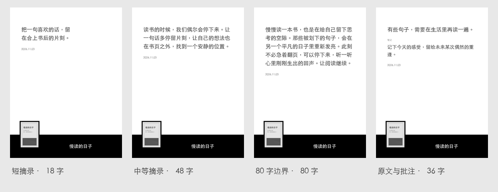

# 留句 · liuju.koplugin

把当前阅读书籍中简短的高亮与批注，排成带封面和标注日期的锁屏壁纸。每次 Kindle 休眠时随机展示一张，换书时自动切换图片池。

**当前版本：0.1.0-rc.8 候选版。** 目标设备为 KPW4，已完成本机回归与桌面视觉检查，尚待 KPW4 实机确认。KOReader 的具体版本待确认；插件使用现代的 annotations 接口。



## 使用体验

- 打开书籍后，自动读取当前书的高亮和批注，分批生成图片。
- 采用黑白播放器版式。正文在上方，日期跟随正文。左下角书封一半露在黑色底栏外，黑框贴合封面比例，白字书名在封面右侧居中。
- 默认上限 80 字；中文、字母、数字和标点各算一字，空白不计。原文与笔记合并计算。
- 字数合格后，以固定字号实际排版；放不下的内容跳过。短摘录会平衡文本块宽度，保持原文和字号。
- 每条标注最多一张壁纸，包含封面、书名、原文或笔记、原始标注日期。页码和章节用于内部识别，不出现在壁纸上。
- 锁屏仅从当前书的目录随机取图。换书立即切走旧池，旧书图片保留作缓存。
- 若已在 KOReader 设置睡眠时不显示某本书的封面，留句会为该书使用通用屏保。
- EPUB 是主要支持格式。PDF 使用通用屏保。
- 编辑、删除标注或调整上限后，同步当前图片池。更新期间或无合格内容时显示当前书的封面壁纸，无封面则使用书名封面。
- 常规阅读与锁屏过程无需联网。

“锁屏”指 KOReader 运行期间的睡眠屏幕。退出 KOReader 后，Kindle 系统锁屏仍由设备原有机制管理。

## 安装候选版

1. 获取名为 `liuju.koplugin-v0.1.0-rc.8.zip` 的安装包，解压得到 `liuju.koplugin` 文件夹。
2. 完全退出 KOReader，将文件夹复制到 Kindle 的：

   ```text
   /mnt/us/koreader/plugins/liuju.koplugin/
   ├── _meta.lua
   ├── main.lua
   ├── liuju_core.lua
   ├── liuju_draw.lua
   ├── liuju_layout.lua
   ├── liuju_policy.lua
   ├── liuju_render.lua
   └── liuju_store.lua
   ```

3. 安全弹出 Kindle，重新启动 KOReader，打开一本书。首次启用默认开启留句屏保。
4. 在“工具 → 留句”中调整字数上限、更新当前书的小票或预览。阅读时预览以当前书的标注为准。

如果同时使用单向历，请先关闭单向历的“自动配置屏保”，再启用留句。两者设置的是同一套 KOReader 屏保。留句发现用户或其他插件改换屏保后，会让出配置并关闭自身开关；需要重新使用时可在菜单里开启。

GitHub 的源码 ZIP 解压后带有分支后缀，手动安装源码时需将目录改为 `liuju.koplugin`。

升级到 rc.8 后，重新打开书籍即可登记完整文件摘要并更新小票。书库中如果原书已删除、被替换或尚未核验，锁屏会使用通用屏保。

在书库调低字数上限时，留句会立即筛选最近一本书的小票。旧版缓存如果还没有字数记录，会先显示封面，重新打开书籍时再核对旧图。

## 图片、设置与停用

```text
/mnt/us/koreader/screenshots/liuju/<book-id>/pool/ 每本书的随机小票 PNG
/mnt/us/koreader/settings/liuju/                 封面回退图和图片索引
```

实际路径以 KOReader 的数据目录为准。同步会清理当前书中失效的小票。误放入 `pool/` 的其他文件会移到同一本书的 `excluded/` 目录。

关闭“启用留句屏保”会停止任务，恢复仍由留句管理的设置，并保留之后的手动改动。正常关书会保留最近一本书的图片池。卸载前建议先关闭该开关，再退出 KOReader 删除插件文件夹。已生成图片可按上述目录另行清理，书籍及原始标注保持完整。

缺少日期的标注隐藏日期；带 HTML/Markdown 格式的导入笔记在首版跳过，避免把格式标记当成正文。普通高亮和纯文本笔记是首版支持对象。

## 开发与验证

开发依赖仅用于本机预览和检查，Kindle 插件直接使用 KOReader 内置组件。

```sh
python3 -m venv .venv
.venv/bin/pip install -r requirements-dev.txt
.venv/bin/python tests/run.py
.venv/bin/python tools/preview.py
.venv/bin/python tools/package.py
```

桌面预览通过同一份 Lua 排版与渲染流程生成，替换了字体栅格化与 PNG 编码适配层。默认使用 macOS 黑体；其他系统可用 `--font`、`--bold-font` 指定中文字体。KOReader 自带字体的实际字形和灰阶仍以设备显示为准。

本地回归覆盖 UTF-8 字数边界、原文加笔记、缓存复用、标注增删改、换书取消、失败写入、资源释放、屏保恢复及 DPI 只缩放一次。原生 KOReader 的绘图接口采用替身进行契约检查，不能替代真实设备测试。

- [产品意图与首版规则](docs/PRODUCT-INTENT.md)
- [开发流程与验收标准](docs/DEVELOPMENT-WORKFLOW.md)
- [实现与接口核验记录](docs/IMPLEMENTATION-STATUS.md)
- [KPW4 实机验收步骤](docs/DEVICE-VALIDATION.md)
- [候选版变更记录](CHANGELOG.md)

中文名称为「留句」，GitHub 仓库名和安装目录统一使用 `liuju.koplugin`。

实现参考：[danxiangli.koplugin](https://github.com/iamzhangjinpeng/danxiangli.koplugin) 的屏保备份、任务取消和临时文件替换思路。图片排版、标注筛选与按书同步为留句独立实现。
