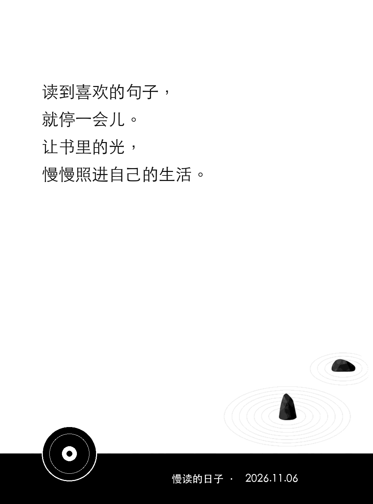
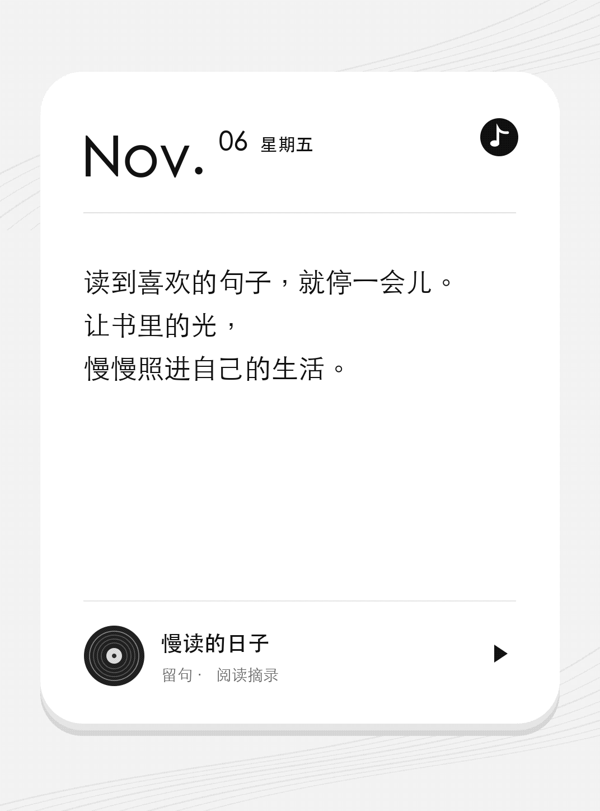
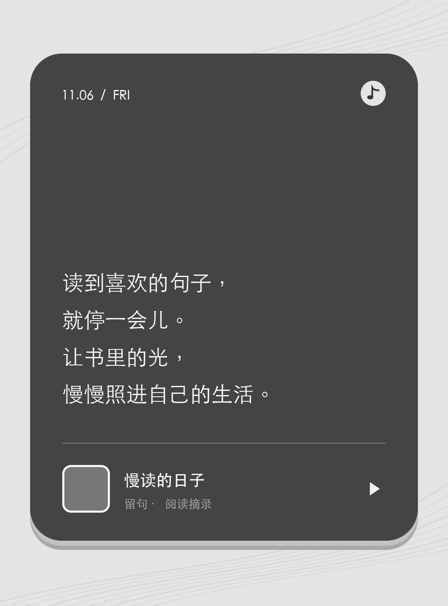

# 留句 · liuju.koplugin

把当前阅读书籍中简短的高亮与批注，排成带书名和标注日期的锁屏壁纸。每次 Kindle 休眠时随机展示一张，换书时自动切换图片池。

**当前正式版为 1.1.0。** 留句面向已越狱并安装 KOReader 的 Kindle，主要支持 EPUB。0.1.1 的壁纸基础功能已在 Kindle Paperwhite 4（KOReader v2026.07.2）通过实机测试。

## 三种壁纸预览

三张图使用同一条摘录，按 Kindle Paperwhite 4 的 1072 × 1448 分辨率渲染。

| 原版半露 CD（默认） | 白底日期卡 | 纯色深灰卡 |
| --- | --- | --- |
|  |  |  |
| 书名和日期在黑栏同一行居中。 | 顶部用大字号显示标注日期。 | 深灰底配白字，摘录靠下。 |

## 使用体验

- 打开书籍后，自动读取当前书的高亮和批注，分批生成图片。
- 可选原版半露 CD、白底日期卡和纯色深灰卡。默认款在黑栏里横排书名和日期，左下角是纯黑白唱片。三种版式均不读取书封。
- 默认上限 80 字；中文、字母、数字和标点各算一字，空白不计。原文与笔记合并计算。
- 字数合格后，以固定字号实际排版；放不下的内容跳过。排版只调整换行，保留原文。
- 每条标注最多一张壁纸，包含书名、高亮或批注，以及原始标注日期。页码和章节用于内部识别，不出现在壁纸上。
- 锁屏仅从当前书的目录随机取图。换书立即切走旧池，旧书图片保留作缓存。
- 若已在 KOReader 设置睡眠时不显示某本书的封面，留句会为该书使用通用屏保。
- EPUB 是主要支持格式。PDF 使用通用屏保。
- 编辑、删除标注或调整上限后，同步当前图片池。
- 常规阅读与锁屏过程无需联网。

“锁屏”指 KOReader 运行期间的睡眠屏幕。设备由 Kindle 系统管理休眠屏幕时，留句会让出屏保设置。

## 安装

1. 下载并解压安装包，得到 `liuju.koplugin` 文件夹。[下载 liuju.koplugin-v1.1.0.zip](https://github.com/iamzhangjinpeng/liuju.koplugin/releases/download/v1.1.0/liuju.koplugin-v1.1.0.zip)
2. 完全退出 KOReader，将文件夹复制到 Kindle 的：

   ```text
   /mnt/us/koreader/plugins/liuju.koplugin/
   ├── _meta.lua
   ├── main.lua
   ├── liuju_core.lua
   ├── liuju_draw.lua
   ├── liuju_layout.lua
   ├── liuju_policy.lua
   ├── liuju_render.lua
   ├── liuju_store.lua
   └── assets/                 # 1.1.0 的三张壁纸底图
   ```

3. 安全弹出 Kindle，重新启动 KOReader，打开一本书。首次启用默认开启留句屏保。

如果同时使用单向历，请先关闭单向历的“自动配置屏保”，再启用留句。两者设置的是同一套 KOReader 屏保。留句发现用户或其他插件改换屏保后，会让出配置并关闭自身开关；需要重新使用时可在菜单里开启。

1.1.0 安装包包含八个 Lua 文件和三张底图。复制插件时保留完整的 `assets/` 目录。

升级至 1.1.0 后，重新打开书籍即可用新样式生成小票。书库中如果原书已删除、被替换或尚未核验，锁屏会使用通用屏保。若只是暂时无法核验，原书恢复后可在下次休眠时继续显示小票。

## 菜单功能

在 KOReader 的阅读界面或书库打开「工具 → 留句」。

| 菜单项 | 用法 |
| --- | --- |
| 启用留句屏保 | 默认开启，打开书后自动生成小票，并用作 KOReader 的锁屏壁纸。关闭后停止生成，恢复仍由留句管理的屏保设置。 |
| 字数上限 | 可设为 1 到 200 字，默认 80 字。高亮原文和批注合计，空白不计，中文、字母、数字和标点各算一字。排版放不下的标注也会跳过。 |
| 更新当前书的小票 | 阅读 EPUB 等支持的书籍时，可以手动重新生成小票。完成后会显示可用张数和跳过条数。该操作需要启用留句屏保。 |
| 预览一张 | 阅读时随机预览当前书的一张小票。生成中或暂无小票时会提示状态。在书库可以预览最近一本经核对的书。 |
| 壁纸样式（1.1.0） | 单选「原版半露 CD（默认）」「白底日期卡」或「纯色深灰卡」。所选样式在重启后保留。启用留句屏保时，切换会离线重绘当前书的小票。在书库切换时，使用最近一本经核对的书的已保存标注。 |

在书库启用留句时，会尝试恢复最近一本经核对的书的小票；若只是旧版保存了启用状态、尚未接管屏保，重启 KOReader 后也会尝试恢复。最近一本书的批注会重新核对，已删除或修改摘录对应的旧图不会显示。调低字数上限时，留句会立即筛选最近一本书的小票。旧版缓存如果缺少可核对的记录，重新打开书籍即可生成新图。

### 当前书没有高亮时

有符合字数和排版限制的纯文本批注，留句会用批注生成小票。高亮和批注都没有，或者全部超限、排不下时，留句会显示 **KOReader 自带的通用屏保图**。「预览一张」会提示「当前书暂无小票」。生成过程中，第一张可用小票就绪后会自动接替通用屏保。

## 图片缓存与卸载

```text
/mnt/us/koreader/screenshots/liuju/<book-id>/pool/ 每本书的随机小票 PNG
/mnt/us/koreader/settings/liuju/                 图片索引及旧版本缓存
```

实际路径以 KOReader 的数据目录为准。同步会清理当前书中失效的小票。误放入 `pool/` 的其他文件会移到同一本书的 `excluded/` 目录。

正常关书会保留最近一本书的图片池。

### 完整卸载

1. 在 KOReader 打开“工具 → 插件管理 → 用户插件”，长按“留句”，选择“删除插件和设置”（`Delete plugin and settings`）。这一步会恢复仍由留句管理的屏保设置，并删除插件本体和留句的偏好设置。如果留句已在插件管理中停用，可先重新启用并重启 KOReader，再执行删除。[KOReader 插件管理实现](https://github.com/koreader/koreader/blob/master/frontend/pluginloader.lua#L401-L444)
2. 完全退出 KOReader，再通过 USB 连接 Kindle。删除以下两个留句专用目录，清除已生成的小票、索引和旧版本缓存。想保留的图片可先复制出来，误放进图片池的文件可能已移到 `excluded/`。

   ```text
   /mnt/us/koreader/screenshots/liuju/
   /mnt/us/koreader/settings/liuju/
   ```

3. 安全弹出 Kindle。再次打开 KOReader 时，可在屏保设置里确认原来的屏保已恢复，或后来手动选择的屏保仍在使用。

如果菜单里没有“删除插件和设置”，先在“工具 → 留句”关闭“启用留句屏保”，让留句恢复屏保设置。完全退出 KOReader 后，手动删除 `/mnt/us/koreader/plugins/liuju.koplugin/` 和上面两个缓存目录。若也要清除留句偏好，可先备份 `/mnt/us/koreader/settings.reader.lua`，再用文本编辑器删除其中的 `liuju_enabled`、`liuju_character_limit`、`liuju_wallpaper_style`、`liuju_last_book` 和残留的 `liuju_screensaver_lease` 条目。如果 `plugins_disabled` 里有 `liuju` 条目，也可以一并移除。保留全局设置文件和其他条目。

书籍、阅读进度、原始高亮和批注都保留。只删除上面列出的留句目录即可，书籍旁的 `.sdr` 目录用于保存阅读数据。

缺少日期的标注隐藏日期；带 HTML/Markdown 格式的导入笔记在首版跳过，避免把格式标记当成正文。普通高亮和纯文本笔记是首版支持对象。

## 开发与验证

开发依赖仅用于本机预览和检查，Kindle 插件直接使用 KOReader 内置组件。

```sh
python3 -m venv .venv
.venv/bin/pip install -r requirements-dev.txt
.venv/bin/python tests/run.py
.venv/bin/python tools/preview.py
.venv/bin/python tools/package.py
```

桌面预览通过同一份 Lua 排版与渲染流程生成，替换了字体栅格化与 PNG 编码适配层。默认使用 macOS 黑体；其他系统可用 `--font`、`--bold-font` 指定中文字体。KOReader 自带字体的实际字形和灰阶仍以设备显示为准。

本地回归覆盖 UTF-8 字数边界、原文加笔记、缓存复用、标注增删改、换书取消、失败写入、资源释放、屏保恢复及 DPI 只缩放一次。原生 KOReader 的绘图接口采用替身进行契约检查，不能替代真实设备测试。

- [产品意图与首版规则](docs/PRODUCT-INTENT.md)
- [开发流程与验收标准](docs/DEVELOPMENT-WORKFLOW.md)
- [实现与接口核验记录](docs/IMPLEMENTATION-STATUS.md)
- [KPW4 实机验收步骤](docs/DEVICE-VALIDATION.md)
- [版本变更记录](CHANGELOG.md)

中文名称为「留句」，GitHub 仓库名和安装目录统一使用 `liuju.koplugin`。

实现参考：[danxiangli.koplugin](https://github.com/iamzhangjinpeng/danxiangli.koplugin) 的屏保备份、任务取消和临时文件替换思路。三种壁纸的底图和版式参考 [一言壁纸](https://github.com/iamzhangjinpeng/yiyan.koplugin)。
